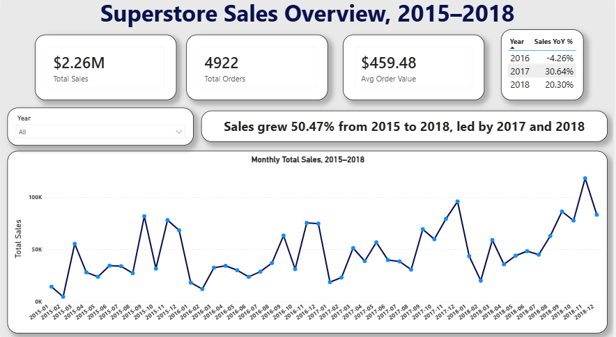
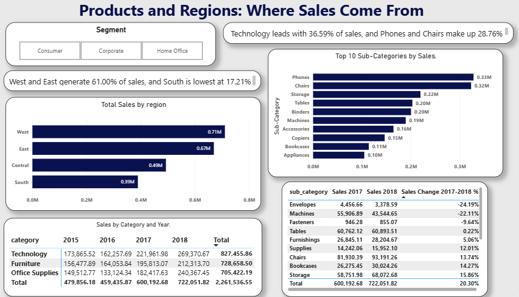
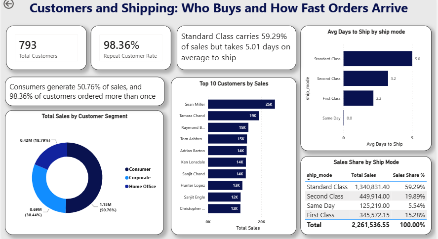

# Superstore Business Performance Diagnosis

A sales performance analysis of 9,800 retail order lines (2015–2018), built with Python, SQL, and Power BI. The project identifies where sales come from, which products and regions are changing, and how customers and shipping affect the business.

## Business Questions

1. How have total sales, orders, and average order value changed from 2015 to 2018?
2. Which regions, categories, and sub-categories generate the most sales?
3. Which sub-categories grew or declined between 2017 and 2018?
4. Which customer segments and customers are most valuable?
5. How often do customers return, and how quickly do orders ship?

## Dataset

- **Source:** Superstore sales data (downloaded from Kaggle as `archive.zip`, containing `train.csv`). Renamed to `superstore_orders_raw.csv`.
- **Size:** 9,800 rows and 18 columns, covering January 2015 to December 2018.
- **Key columns:** Order ID, Order Date, Ship Date, Ship Mode, Customer ID, Segment, Region, Category, Sub-Category, Sales.
- **Limitation:** The dataset has **Sales only**. It has no Profit, Quantity, or Discount columns, so the analysis describes revenue, not profitability.

## Tools

- **Python** (pandas, NumPy, Matplotlib, Seaborn): data loading, cleaning, feature engineering, and exploratory analysis
- **SQL** (PostgreSQL, pgAdmin): table creation, business queries, and data checks
- **Power BI Desktop**: a 3-page interactive dashboard with DAX measures

## Project Structure

```
superstore-business-performance-diagnosis/
├── data/                  raw and cleaned CSV files
├── notebooks/             Python cleaning and EDA notebook
├── sql/                   business queries
├── dashboard/             Power BI file
├── screenshots/           dashboard screenshots
└── README.md
```

## How to Run

1. Clone this repository and open the folder in VS Code.
2. Create a virtual environment and install the libraries:
   ```bash
   pip install pandas numpy matplotlib seaborn sqlalchemy psycopg2-binary jupyter
   ```
3. Open `notebooks/01_cleaning_and_eda.ipynb` and run all cells. This creates `data/superstore_clean.csv`.
4. Create a PostgreSQL database named `superstore`, load the cleaned data, and run the queries in `sql/business_queries.sql`.
5. Open `dashboard/superstore_dashboard.pbix` in Power BI Desktop. Update the database connection if needed.

## Key Findings

- **Sales grew 50.47%** from $479,856.21 in 2015 to $722,052.02 in 2018. 2016 dipped 4.26%, followed by growth of 30.64% in 2017 and 20.30% in 2018.
- **West and East generate 61.00% of sales**, while **South is the smallest region** at 17.21%.
- **Technology is the largest category** at $827,455.87 (36.59%).
- **Phones and Chairs make up 28.76% of sales**, and the top 10 sub-categories make up 88.03%.
- **Consumers generate 50.76% of sales**, and **98.36% of customers ordered more than once**.
- **Standard Class carries 59.29% of sales** but is the slowest option, averaging 5.01 days to ship.
- From 2017 to 2018, **Envelopes fell 24.2%** and **Machines fell 22.1%**, while **Appliances rose 54.6%**.

## Recommendations

1. **Protect Phones and Chairs.** Together they make up 28.76% of sales, so stock and pricing for these products should stay strong.
2. **Investigate the decline in Machines and Envelopes.** Review whether the cause is competition, pricing, or lower demand.
3. **Build sales in the South region.** Review sales coverage and customer reach there, and compare it with the West and East regions.

## Dashboard

| Page | Title | Screenshot |
|---|---|---|
| 1. Overview | Superstore Sales Overview, 2015–2018 |  |
| 2. Products and Regions | Products and Regions: Where Sales Come From |  |
| 3. Customers and Shipping | Customers and Shipping: Who Buys and How Fast Orders Arrive |  |

## Tools and Skills Demonstrated

- Data cleaning and feature engineering with pandas
- SQL joins, aggregations, window functions, and conditional logic
- DAX measures, time intelligence, and interactive dashboard design
- Translating data into business findings and recommendations

## Author

[Sunidhi Jangid] · [www.linkedin.com/in/sunidhi-jangid-625318297] · [jangidsunidhi82@gmail.com]
